# Túi Khôn · PRM393 · Nhóm 5

Báo cáo chức năng và thiết kế hệ thống

Sổ ghi chép tài chính cá nhân trên Android.

Nhóm 5 trình bày nhu cầu người dùng, công nghệ, mô hình dữ liệu, nghiệp vụ và các luồng xử lý của Túi Khôn. Báo cáo đi kèm slide HTML 18 trang cho buổi thuyết trình 12–15 phút.

**Họ tên và MSSV:** [Bổ sung danh sách thành viên thực tế]

**Phân công:** [Bổ sung công việc tương ứng từng thành viên]

Ngày biên soạn: 06/11/2026.

## Mục lục

1. [1 Tổng quan dự án](#section-1)
2. [2 Người dùng và bản đồ chức năng](#section-2)
3. [3 Công nghệ và lý do sử dụng](#section-3)
4. [4 Kiến trúc tổng thể](#section-4)
5. [5 Quản lý trạng thái và vòng đời](#section-5)
6. [6 Mô hình dữ liệu và quan hệ](#section-6)
7. [7 Từ điển dữ liệu nghiệp vụ](#section-7)
8. [8 Kho cục bộ và hợp đồng API](#section-8)
9. [9 Tiền tệ nguồn tiền và danh mục](#section-9)
10. [10 Ngân sách và mục tiêu](#section-10)
11. [11 Sổ nợ và giao dịch liên kết](#section-11)
12. [12 Tài khoản và bootstrap](#section-12)
13. [13 Ghi sửa và xóa giao dịch](#section-13)
14. [14 Ghi nhanh giọng nói và hóa đơn](#section-14)
15. [15 Quota fallback và nhận xét AI](#section-15)
16. [16 Sửa hoàn tác và lịch sử trả nợ](#section-16)
17. [17 Khoản phải trả và nhắc nhở](#section-17)
18. [18 Thống kê báo cáo và CSV](#section-18)
19. [19 Widget Android ghi nhanh](#section-19)
20. [20 Ảnh giao diện và dữ liệu minh họa](#section-20)
21. [21 Đồng bộ offline và idempotency](#section-21)
22. [22 Phát hiện và lựa chọn xung đột](#section-22)
23. [23 Bảo mật và quyền riêng tư](#section-23)
24. [24 Kiểm thử và kết quả xác minh](#section-24)
25. [25 Kịch bản demo và thuyết trình](#section-25)
26. [26 Chạy source bài học và phát triển](#section-26)

## 1 Tổng quan dự án

Túi Khôn là ứng dụng sổ ghi chép tài chính cá nhân trên thiết bị di động. Dự án giúp người dùng ghi lại thu chi ngay khi phát sinh, theo dõi nguồn tiền, lập kế hoạch và xem lại thói quen chi tiêu. Báo cáo dành cho giảng viên và sinh viên môn PRM393, trình bày chức năng, công nghệ, nghiệp vụ và cách kiểm chứng hệ thống của Nhóm 5.

### 1 1 Vấn đề cần giải quyết

Các khoản chi nhỏ dễ bị bỏ quên khi việc ghi chép có nhiều bước. Dữ liệu nằm rải rác giữa ghi chú, ảnh hóa đơn và trí nhớ khiến người dùng khó biết mình còn bao nhiêu tiền, đã gần vượt ngân sách hay còn khoản nợ nào. Mạng di động cũng có thể gián đoạn đúng lúc cần ghi lại một giao dịch.

### 1 2 Mục tiêu

Ứng dụng rút ngắn thao tác bằng form thu chi, ghi nhanh bằng ngôn ngữ tự nhiên, ảnh hóa đơn và widget Android. SQLite giữ dữ liệu trên thiết bị; đồng bộ đưa thay đổi lên Supabase khi có mạng. Báo cáo và kế hoạch sử dụng cùng dữ liệu đã ghi, giúp người dùng đánh giá quyết định chi tiêu thay vì chỉ lưu danh sách giao dịch.

*Bảng 1. Mục tiêu và biểu hiện trong sản phẩm*

| Mục tiêu | Cách đáp ứng |
| --- | --- |
| Ghi đúng và nhanh | Định dạng tiền khi nhập; bản nháp AI phải được xác nhận. |
| Dùng được khi mất mạng | Đọc SQLite; dữ liệu và outbox được ghi trong cùng transaction. |
| Nhất quán nhiều thiết bị | UUID, version, retry idempotent và lựa chọn khi xung đột. |
| Hiểu tình hình tài chính | Báo cáo tháng, ngân sách, mục tiêu, sổ nợ và nhắc việc. |

### 1 3 Phạm vi

Đây là sổ ghi chép, không thực hiện thanh toán hay chuyển tiền. Nguồn tiền là nhãn theo dõi do người dùng quản lý, không phải kết nối ngân hàng. Phạm vi trình bày là Android dùng thử nội bộ; iOS và phát hành cửa hàng là hướng phát triển tiếp theo. Không bổ sung chia tiền nhóm hoặc gói PRO.

## 2 Người dùng và bản đồ chức năng

Người dùng mục tiêu là sinh viên và người đi làm muốn chủ động theo dõi tiền cá nhân. Một tài khoản có thể dùng trên nhiều thiết bị; mỗi thiết bị có kho SQLite riêng cho từng tài khoản. Không có vai trò quản trị tài chính của người khác trong ứng dụng.

*Bảng 2. Các nhóm chức năng*

| Nhóm | Năng lực chính | Giá trị sử dụng |
| --- | --- | --- |
| Tài khoản | Email, OTP, khôi phục mật khẩu, Google, khóa sinh trắc | Xác thực và tách dữ liệu |
| Ghi chép | Thu chi, nguồn tiền, danh mục, ảnh, lịch sử | Lưu đúng sự kiện tài chính |
| Ghi nhanh | Văn bản, giọng nói thành chữ, quét hóa đơn | Giảm thao tác nhập lại |
| Lập kế hoạch | Ngân sách, mục tiêu, nợ, khoản phải trả | Theo dõi cam kết tương lai |
| Theo dõi | Thống kê, báo cáo tháng, nhận xét AI, CSV | Xem lại và trao đổi dữ liệu |
| Trải nghiệm | Widget, nhắc nhở, sáng tối, Việt Anh | Tiếp cận nhanh và phù hợp thiết bị |

### 2 1 Một ngày sử dụng điển hình

Buổi sáng, người dùng bấm Chi trên widget để ghi tiền ăn. Khi có hóa đơn, người dùng chọn Quét ảnh, sửa bản nháp rồi lưu. Cuối ngày, màn lịch sử cho phép đối chiếu các khoản đã ghi; ngân sách hiển thị mức sử dụng và khoản phải trả nhắc những việc chưa hoàn thành. Cuối tháng, báo cáo tổng hợp theo kỳ Việt Nam giúp xem biến động so với tháng trước.

### 2 2 Nguyên tắc tương tác

Mọi luồng tạo giao dịch đều kết thúc ở bước người dùng xác nhận. Đóng form hoặc hủy bản nháp không phát sinh giao dịch. Tình trạng đang chờ đồng bộ và xung đột phải quan sát được; hệ thống không âm thầm chọn một bản khi hai thiết bị sửa cùng dữ liệu. Số dư, kế hoạch và lịch sử luôn phản ánh dữ liệu của tài khoản hiện tại.

## 3 Công nghệ và lý do sử dụng

Hệ thống gồm ứng dụng Flutter, một phần Android native cho widget và backend Supabase. Không có Java backend hoặc Firebase trong kiến trúc hiện tại. Các thư viện phục vụ từng trách nhiệm cụ thể để UI không phải tự quản lý SQL, phiên đăng nhập hay quy tắc tiền.

*Bảng 3. Công nghệ sử dụng*

| Công nghệ | Vai trò và lý do lựa chọn |
| --- | --- |
| Flutter và Dart | Xây dựng UI mobile nhất quán; một codebase cho các màn và logic trình bày. |
| Riverpod | Cung cấp dependency và state phản ứng; làm mới UI theo tài khoản, dữ liệu và tùy chọn. |
| SQLite và Drift | Lưu cục bộ có transaction, query phản ứng và khả năng kiểm thử không phụ thuộc mạng. |
| Supabase Auth | Phiên đăng nhập email hoặc Google; JWT làm căn cứ xác định người dùng. |
| PostgreSQL và RLS | Ràng buộc dữ liệu, RPC đồng bộ, kiểm soát quyền theo user_id ở máy chủ. |
| Supabase Storage | Lưu ảnh hóa đơn trong bucket riêng tư; avatar có chính sách riêng. |
| Edge Functions và Gemini | Deno TypeScript kiểm tra yêu cầu, quota và JSON trước khi gọi mô hình. |
| Kotlin và RemoteViews | Widget launcher Android bằng API native, không thêm plugin Flutter. |
| MethodChannel | Cầu nối action widget sang Flutter và cập nhật nhãn, theme về native. |
| Thư viện thiết bị | speech_to_text, image_picker, local_auth, thông báo và chia sẻ tệp. |

### 3 1 Công cụ phát triển

Môi trường bàn giao đã dùng Flutter 3.47.7, Dart 3.13.5 và Java 17 cho Android. SETUP.md là hướng dẫn tái lập; cần giữ pubspec.lock thay vì nâng cấp thư viện tùy ý. Node.js phục vụ công cụ Supabase và kiểm thử SQL, không thay thế backend PostgreSQL. Docker chỉ cần khi chạy backend local.

### 3 2 Đánh đổi

Local-first làm trải nghiệm ổn định khi mất mạng nhưng tăng độ phức tạp đồng bộ và xung đột. Supabase giảm công sức xây dựng Auth và Storage, đổi lại ứng dụng phải tôn trọng RLS và hợp đồng RPC. Widget native cần quản lý vòng đời Android riêng, nhưng dùng lại form và repository Flutter để tránh hai cách ghi dữ liệu khác nhau.

## 4 Kiến trúc tổng thể

UI đọc dữ liệu qua provider và repository; SQLite là nguồn dữ liệu trực tiếp của các màn. SyncController vận chuyển thay đổi giữa kho cục bộ và Supabase. AI là dịch vụ hỗ trợ tạo bản nháp, không đi vòng qua repository để ghi giao dịch.

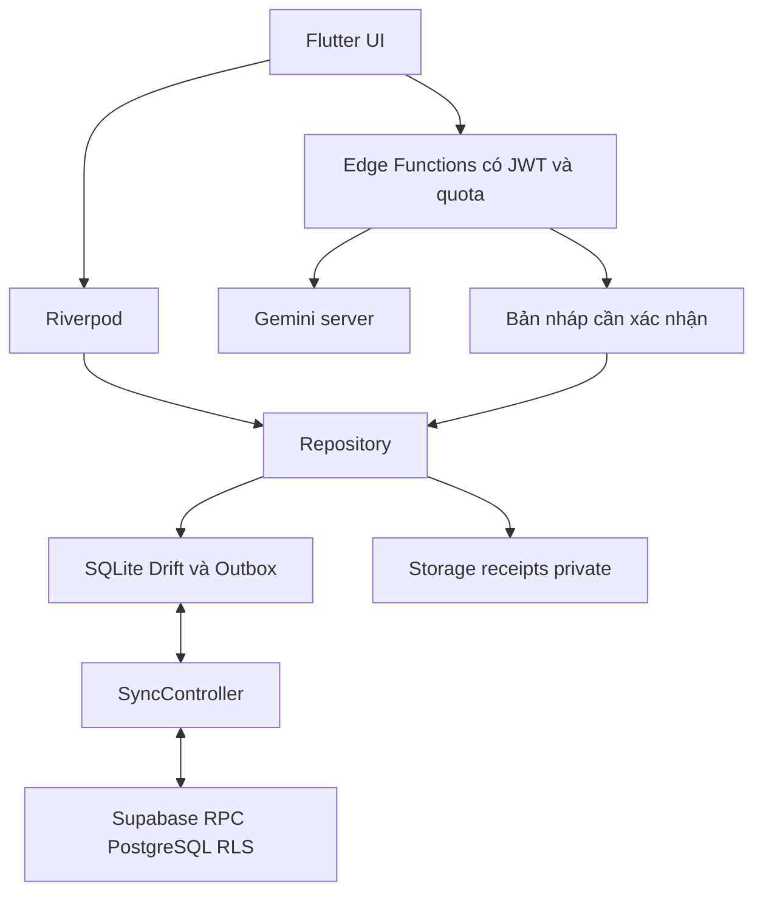

*Hình 1. Các tầng và đường đi của dữ liệu*

### 4 1 Phân chia trách nhiệm

Tầng presentation nhận thao tác, hiển thị lỗi đã bản địa hóa và giữ trạng thái form. Riverpod nối dependency và trạng thái với màn hình. Repository kiểm tra nghiệp vụ và điều phối transaction. LocalStore quản lý bản ghi, outbox, con trỏ, xung đột và ảnh chờ tải. Remote dùng Auth, RPC và Storage theo hợp đồng máy chủ.

### 4 2 Hai đường dữ liệu

Đường ghi thông thường là UI → repository → transaction SQLite gồm dữ liệu và outbox; UI thấy kết quả ngay sau commit. Đường đồng bộ là outbox → sync_push → PostgreSQL rồi sync_pull → SQLite. Kết quả từ AI đi vào bản nháp của UI và chỉ nhập vào đường ghi thông thường sau xác nhận.

### 4 3 Ranh giới tin cậy

Flutter chứa URL và publishable key để gọi API công khai có xác thực; không chứa Gemini key hoặc service role. Quyền sở hữu cuối cùng được kiểm tra trên server. Widget chỉ truyền action định trước, không nhận SQL hay số tiền tùy ý để tạo giao dịch nền.

## 5 Quản lý trạng thái và vòng đời

Một ứng dụng mobile không chạy liên tục. Hệ điều hành có thể đưa app xuống nền hoặc kết thúc tiến trình; vì vậy dữ liệu quan trọng phải được commit xuống SQLite, không chỉ tồn tại trong provider hoặc bộ nhớ của form.

### 5 1 State theo trách nhiệm

Trạng thái phiên đăng nhập quyết định tài khoản được mở. Trạng thái bootstrap xác định kho local đã sẵn sàng. Trạng thái đồng bộ cho biết đang chạy, chờ mạng, lỗi hay có xung đột. Trạng thái form và bản nháp thuộc thao tác đang nhập. Tách các trạng thái này giúp không nhầm việc có phiên Auth với việc dữ liệu đã tải xong.

*Bảng 4. Sự kiện vòng đời và phản ứng*

| Sự kiện | Phản ứng của hệ thống |
| --- | --- |
| Khởi động lần đầu | Cần mạng để xác thực và bootstrap dữ liệu tài khoản. |
| Mở lại tài khoản đã bootstrap | Đọc SQLite; có thể tiếp tục ghi khi mạng gián đoạn. |
| App trở lại foreground | Kiểm tra khóa, tiếp tục hàng đợi và thử đồng bộ khi phù hợp. |
| App xuống nền | Bảo vệ nội dung bằng khóa khi đạt ngưỡng; không hứa đồng bộ vô hạn. |
| Phiên hết hạn khi offline | Giữ dữ liệu cục bộ; cần xác thực lại để tiếp tục thao tác server. |
| Đăng xuất hoặc đổi tài khoản | Đóng ngữ cảnh tài khoản; xóa yêu cầu widget cũ, giữ tùy chọn thiết bị. |

### 5 2 Tùy chọn theo thiết bị

Theme và ngôn ngữ lưu bằng SharedPreferences, được nạp trước khi dựng UI. Mặc định theme theo hệ thống và ngôn ngữ Việt; ngôn ngữ hệ thống không được hỗ trợ sẽ dùng Việt. Đăng xuất không xóa các lựa chọn này. Khi ghi tùy chọn lỗi, state và cache phải được khôi phục nhất quán.

### 5 3 Hệ quả với thiết kế

Bootstrap lỗi phải có thông báo và hành động thử lại. Yêu cầu widget vẫn chờ cho đến khi tài khoản, dữ liệu, khóa và foreground sẵn sàng. Form đang sửa không bị thay thế bởi một action mới; nhờ đó vòng đời app không làm mất nội dung người dùng vừa nhập.

## 6 Mô hình dữ liệu và quan hệ

Các thực thể nghiệp vụ gắn với người dùng Auth bằng user_id. Sơ đồ dưới đây thể hiện các quan hệ chính phục vụ việc ghi chép và kế hoạch; quan hệ sở hữu lặp lại được rút gọn để dễ đọc. Những liên kết tùy chọn phải được kiểm tra cùng chủ sở hữu ở server.

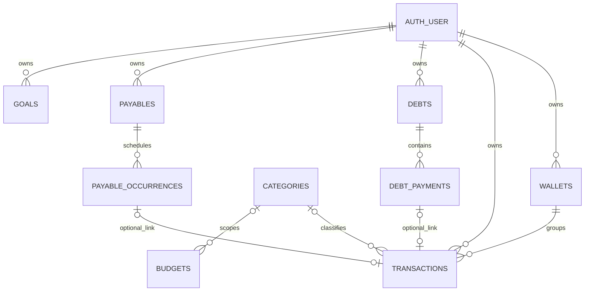

*Hình 2. ERD rút gọn của dữ liệu nghiệp vụ*

### 6 1 Tổ chức theo tài khoản

profiles chứa thông tin hồ sơ. wallets và categories phân loại transactions. budgets ràng buộc số tiền theo tháng và có thể theo danh mục. goals ghi mục tiêu tích lũy. debts có nhiều debt_payments; mỗi lần trả có thể liên kết một giao dịch tiền. payables sinh các payable_occurrences cho từng kỳ cần thực hiện.

### 6 2 Các bảng hỗ trợ

notifications lưu thông tin nhắc việc; ai_usage phục vụ quota theo ngày; category_rules lưu quy tắc phân loại học từ điều chỉnh đã xác nhận. Tổng cộng có 13 bảng public ở bản cloud đã kiểm tra. Nhật ký sync_changes và sổ operation sync_ops thuộc cơ chế đồng bộ riêng, không phải danh sách giao dịch cho UI.

### 6 3 Xóa và lịch sử

Bản ghi có version và deleted để truyền được thay đổi và tombstone sang thiết bị khác. Không suy diễn rằng xóa một danh mục sẽ xóa toàn bộ giao dịch của nó. Quy tắc repository và RPC xử lý việc tháo liên kết hoặc xóa các dữ liệu phụ thuộc theo nghiệp vụ, đồng thời bảo vệ lịch sử tài chính.

## 7 Từ điển dữ liệu nghiệp vụ

Bảng mô tả các trường và bất biến quan trọng, không thay thế toàn bộ DDL. Tên trường trong mã nguồn là hợp đồng kỹ thuật; nhãn hiển thị được dịch độc lập. Tiền dùng số nguyên VND, định danh dùng UUID và thời điểm trao đổi với server dùng timestamp.

*Bảng 5. Nhóm dữ liệu chính*

| Thực thể | Nội dung và ràng buộc |
| --- | --- |
| wallets | Tên nguồn, số dư ban đầu; nguồn liên kết giao dịch phải thuộc cùng tài khoản. |
| categories | Tên, loại thu hoặc chi, icon và màu; không được đổi nghĩa giao dịch chỉ vì đổi ngôn ngữ. |
| transactions | Loại, số tiền, nguồn, danh mục, ngày phát sinh, ghi chú, ảnh; khoản liên kết chịu quy tắc repository. |
| budgets | Hạn mức tháng tổng hoặc theo danh mục; theo dõi chi tiêu và mức cảnh báo. |
| goals | Mức mục tiêu và tiến độ ghi nhận; đóng góp hoặc rút tiến độ không tự chuyển tiền. |
| debts | Loại vay hoặc cho vay, đối tác, gốc, hạn; tổng đã trả được quản lý từ lịch sử trả nợ. |
| debt_payments | Khoản trả từng phần, ngày, ghi chú, liên kết giao dịch tùy chọn; không cho trả quá phần còn lại. |
| payables và occurrences | Quy tắc lịch và từng kỳ thực hiện; mỗi kỳ có định danh ổn định để tránh trùng. |
| profiles và notifications | Hồ sơ và nhắc việc theo chủ sở hữu; không thay thế Auth. |
| ai_usage và category_rules | Hạn mức AI và quy tắc phân loại do người dùng kiểm soát. |

### 7 1 Metadata đồng bộ

Định danh bản ghi được giữ qua retry và thiết bị. version thể hiện phiên bản server đã chấp nhận, không phải thời gian trên điện thoại. deleted biểu diễn xóa logic. created_at và updated_at do hợp đồng server quản lý; client không được tự ghi đè các trường bảo vệ bằng payload tùy ý.

### 7 2 Giá trị mặc định

Tài khoản mới bootstrap 22 danh mục và một nguồn tiền theo cấu hình dự án. Các giá trị này hỗ trợ bắt đầu ghi chép; không phải dữ liệu chi tiêu của người dùng và không phải số dư từ ngân hàng. Báo cáo chỉ tính các giao dịch hợp lệ, chưa bị xóa, trong kỳ được chọn.

## 8 Kho cục bộ và hợp đồng API

LocalStore dùng cấu trúc bản ghi theo loại thực thể. Dữ liệu cục bộ có thể mới hơn server khi còn outbox, vì vậy không được thay toàn bộ SQLite bằng một response tải về mà bỏ qua các thay đổi chưa đồng bộ.

*Bảng 6. Cấu trúc lưu cục bộ*

| Thành phần | Nội dung |
| --- | --- |
| records | entity, id, data, version, deleted; bản đọc cho nghiệp vụ. |
| outbox | op_id, entity, record_id, base_version, payload, deleted, state, error, created_at. |
| metadata | Thông tin bootstrap và cursor đã áp dụng thành công. |
| conflicts | Hai bản local và server để người dùng lựa chọn có chủ đích. |
| attachments | Ảnh cục bộ, hash và trạng thái chờ tải lên Storage. |

*Bảng 7. Hợp đồng trao đổi quan trọng*

| Điểm gọi | Dữ liệu và trách nhiệm |
| --- | --- |
| sync_push | Nhận op_id, entity, record_id, base_version, payload, deleted; kiểm tra Auth, quyền, version và nghiệp vụ. |
| sync_pull | Nhận cursor và limit tối đa 500; trả changes, cursor, has_more. Mỗi change có seq, entity, id, row, version, deleted. |
| ai-quick-record | Nhận văn bản hoặc ảnh có phiên đăng nhập; trả cấu trúc bản nháp và thông tin quota. |
| ai-advisor | Nhận phạm vi phân tích hợp lệ; tổng số do server tính, mô hình diễn giải. |
| Storage receipts | Tải ảnh vào vùng của tài khoản; mở ảnh qua URL ký tạm thời. |

### 8 1 Không ghi trực tiếp bảng đồng bộ

Client gửi operation qua RPC thay vì tự update các bảng có version. Server có thể loại bỏ trường chỉ đọc như id, user_id, version, deleted và trường dẫn xuất của nợ. Điều này giữ một đường kiểm tra nhất quán cho replay, quyền sở hữu và giao dịch liên kết.

### 8 2 Áp dụng một trang pull

Các change của một trang và cursor mới phải commit cùng nhau. Nếu app bị dừng trước commit, lần sau đọc lại trang cũ vẫn an toàn; nếu commit xong thì không bỏ sót thay đổi. Không tăng cursor trước khi dữ liệu tương ứng đã nằm trong SQLite.

## 9 Tiền tệ nguồn tiền và danh mục

### 9 1 Tiền nguyên và cách hiển thị

Một đồng VND là đơn vị nhỏ nhất. Dart dùng int, PostgreSQL dùng bigint; không dùng số thực để cộng trừ tiền. Khi nhập 1234567, giao diện Việt hiển thị 1.234.567; giao diện Anh nhóm bằng dấu phẩy. Giá trị lưu vẫn là 1234567. Ô nhập tay giới hạn 13 chữ số và từ chối số lẻ, số mũ hoặc viết tắt; ghi nhanh có bộ phân tích riêng.

### 9 2 Công thức số dư

Số dư nguồn tiền = số dư ban đầu + tổng thu hợp lệ − tổng chi hợp lệ của nguồn đó. Tổng số dư bằng tổng số dư các nguồn. Số âm luôn có dấu trừ; tùy chọn hiển thị dấu cộng không được làm mất dấu âm. Ví dụ nguồn có 2.000.000 VND, thu 500.000 và chi 65.000 thì còn 2.435.000 VND.

*Bảng 8. Các giá trị có ý nghĩa khác nhau*

| Chỉ số | Ý nghĩa |
| --- | --- |
| Số dư nguồn | Dòng tiền đã ghi và số dư ban đầu. |
| Còn phải trả nợ | Gốc vay trừ các khoản đã trả hợp lệ. |
| Tiến độ mục tiêu | Số tiền người dùng ghi nhận để theo dõi mục tiêu. |
| Hạn mức ngân sách | Mức chi dự kiến trong tháng, không phải tiền bị phong tỏa. |

### 9 3 Nguồn tiền và danh mục

Người dùng tạo hoặc sửa tên, màu, icon và số dư ban đầu qua repository. Danh mục phải phù hợp loại thu hoặc chi. Khi xóa danh mục, giao dịch lịch sử được giữ dưới trạng thái không còn danh mục; ngân sách và quy tắc liên quan được xử lý theo quy tắc phụ thuộc. Không cho tham chiếu một nguồn hoặc danh mục của tài khoản khác.

### 9 4 Ngày tài chính

Kỳ ngày và tháng sử dụng giờ Việt Nam UTC+7, độc lập với ngôn ngữ UI và múi giờ thiết bị. Khi tạo báo cáo tháng, hệ thống quy đổi biên kỳ đúng múi giờ trước khi lọc timestamp. Thay đổi Việt sang Anh không đổi VND, kỳ báo cáo hoặc số nguyên trong CSV và outbox.

## 10 Ngân sách và mục tiêu

### 10 1 Ngân sách tháng

Điều kiện: tài khoản đã bootstrap, người dùng có số tiền hạn mức và tháng áp dụng. Đầu vào gồm hạn mức tổng hoặc danh mục; có thể sao chép từ tháng trước. Repository lưu kế hoạch vào SQLite và outbox; UI tính chi tiêu hợp lệ trong cùng kỳ để hiển thị mức sử dụng.

Tỷ lệ sử dụng = tổng chi thuộc phạm vi / hạn mức. Ngưỡng 80% và 100% tạo cảnh báo một lần cho mỗi mức; nếu chi tiêu giảm xuống dưới mức tương ứng thì hệ thống có thể kích hoạt lại ở lần vượt sau. Thu nhập không trực tiếp trừ vào tổng chi dùng để đánh giá ngân sách.

*Bảng 9. Ví dụ ngân sách*

| Tình huống | Kết quả |
| --- | --- |
| Hạn mức 1.000.000, đã chi 790.000 | Hiển thị 79%, chưa chạm ngưỡng 80%. |
| Thêm chi 20.000 | Đạt 81%, kích hoạt mức 80%. |
| Thêm chi 200.000 | Đạt 101%, kích hoạt mức 100%. |
| Sửa hoặc xóa một khoản chi | Tính lại theo dữ liệu thực; không cộng dồn bộ đếm sai. |

### 10 2 Mục tiêu tích lũy

Điều kiện: có tên mục tiêu và mức cần đạt. Người dùng nhập phần đóng góp hoặc phần rút, hệ thống kiểm tra giá trị và cập nhật tiến độ. Khi đạt mức mục tiêu, trạng thái hoàn thành và thông báo được cập nhật. Đây là sổ theo dõi dự định: đóng góp không tự tạo giao dịch chi và rút không tự tạo giao dịch thu.

### 10 3 Ngoại lệ và bảo toàn dữ liệu

Giá trị thiếu, không hợp lệ hoặc không phù hợp giới hạn phải được báo ngay trên form. Đổi danh mục không được tạo tham chiếu chéo tài khoản. Nếu ghi SQLite thất bại thì không để lại outbox riêng lẻ; nếu mạng lỗi sau khi lưu thì kế hoạch vẫn tồn tại cục bộ và được đồng bộ lại sau. Xung đột chỉnh sửa dùng cơ chế version chung.

## 11 Sổ nợ và giao dịch liên kết

Sổ nợ phân biệt tôi vay và tôi cho vay. Tạo một khoản nợ ghi nhận nghĩa vụ hoặc khoản phải thu; mặc định không làm thay đổi số dư nguồn tiền. Muốn phản ánh dòng tiền thực tế, người dùng ghi giao dịch phù hợp hoặc bật liên kết cho lần trả nợ theo luồng được hỗ trợ.

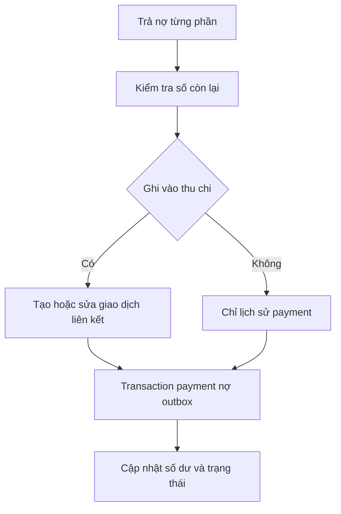

*Hình 3. Trả nợ và dòng tiền được điều phối trong repository*

### 11 1 Trả từng phần

Đầu vào gồm khoản nợ, số tiền trả, ngày, ghi chú và lựa chọn có ghi vào thu chi hay không. Số tiền trả không vượt phần còn lại. Repository ghi payment, tính lại tổng đã trả và trạng thái nợ; nếu có liên kết thì tạo đúng một giao dịch cùng transaction local và cùng cơ chế outbox.

*Bảng 10. Chiều giao dịch liên kết*

| Nghiệp vụ | Giao dịch nếu bật liên kết |
| --- | --- |
| Tôi trả khoản đã vay | Chi từ nguồn tiền được chọn. |
| Người khác trả khoản tôi cho vay | Thu vào nguồn tiền được chọn. |
| Chỉ ghi lịch sử trả nợ | Không tạo dòng tiền; số dư nguồn giữ nguyên. |

### 11 2 Bất biến quan trọng

Tổng đã trả bằng tổng các payment còn hiệu lực; số còn lại bằng gốc trừ tổng đã trả. Một payment chỉ có tối đa một giao dịch liên kết. Nợ, payment và nguồn tiền phải cùng chủ sở hữu. Server kiểm tra lại giới hạn để tránh hai thiết bị cùng ghi các khoản làm vượt nợ; lỗi cần được giữ cho người dùng xử lý, không âm thầm cắt số tiền.

### 11 3 Dữ liệu lịch sử

Các khoản trả tổng hợp từ dữ liệu cũ được đánh dấu legacy và không tự sinh thêm giao dịch. Migration bổ sung giữ nguyên tiền và lịch sử, không giả định rằng số đã trả trong bản cũ tương ứng một dòng tiền mới cần tạo.

## 12 Tài khoản và bootstrap

Luồng tài khoản hỗ trợ đăng ký email, xác nhận OTP 6 chữ số, đăng nhập, quên mật khẩu và Google Sign-In. Google cung cấp ID token cho Supabase xác thực; ứng dụng không tự coi kết quả chọn tài khoản Google là phiên backend hợp lệ. OTP và thư khôi phục dùng cấu hình Auth cùng SMTP của môi trường.

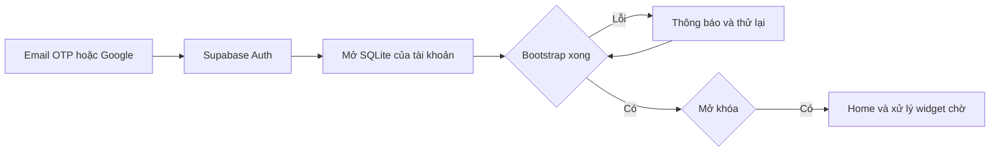

*Hình 4. Đăng nhập và mở dữ liệu tài khoản*

### Điều kiện và đầu vào

Người dùng chưa có phiên hợp lệ hoặc đang mở lại app. Đầu vào là email và mật khẩu, OTP hoặc kết quả Google; đăng nhập ban đầu cần mạng.

### Xử lý và kết quả

AuthGate theo dõi phiên; xác định tài khoản, mở SQLite riêng, bootstrap khi cần và kiểm tra khóa sinh trắc trước khi cho vào nội dung. Sau khi sẵn sàng, home đọc dữ liệu local và các yêu cầu widget đang chờ có thể được xử lý.

### Ngoại lệ cần xử lý

Sai thông tin, OTP hết hạn, người dùng hủy Google hoặc mạng gián đoạn đều phải có thông báo và khả năng thử lại. Bootstrap lỗi không được mở form trên dữ liệu chưa sẵn sàng.

### 12 1 Đổi tài khoản an toàn

Đăng xuất không được gửi outbox của tài khoản cũ bằng phiên mới. Dữ liệu, con trỏ và ảnh được gắn với đúng kho tài khoản. Theme và ngôn ngữ vẫn theo thiết bị. Yêu cầu widget cũ bị hủy khi đăng xuất hoặc đổi tài khoản để không mở nhầm thao tác trong một danh tính khác.

### 12 2 Điều kiện vận hành

Các luồng trực tuyến trong tài liệu được mô tả với giả định môi trường đã cấu hình Auth, Google OAuth, SMTP và Gemini trước buổi demo. Phần kiểm thử ở cuối báo cáo phân biệt năng lực đã triển khai với những bằng chứng thực sự đã chạy, không suy ra kết quả dịch vụ chỉ từ việc deploy source.

## 13 Ghi sửa và xóa giao dịch

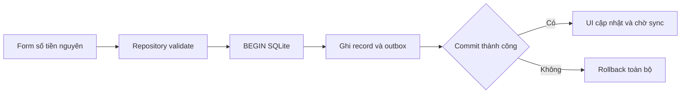

*Hình 5. Lưu giao dịch và outbox nguyên tử*

### Điều kiện và đầu vào

Tài khoản và SQLite đã sẵn sàng, khóa app đã được mở. Form nhận loại thu hoặc chi, số tiền, nguồn tiền, danh mục phù hợp, ngày, ghi chú và ảnh tùy chọn.

### Xử lý và kết quả

UI định dạng tiền để đọc; repository nhận số nguyên, kiểm tra chủ sở hữu và dữ liệu, tạo UUID rồi commit bản ghi cùng operation outbox trong một transaction SQLite. Sau commit, lịch sử và số dư đổi theo dữ liệu local. SyncController có thể đưa operation lên server khi có mạng.

### Ngoại lệ cần xử lý

Thiếu số tiền hoặc nguồn, số không hợp lệ và danh mục sai loại chặn lưu. Lỗi SQLite rollback cả dữ liệu lẫn outbox. Mất mạng sau commit chỉ làm operation chờ, không làm mất giao dịch.

### 13 1 Sửa và xóa

Sửa giữ định danh bản ghi, tạo operation với base_version thích hợp. Xóa dùng tombstone để thiết bị khác biết bản ghi đã bị xóa; không đơn giản xóa hàng local rồi quên gửi server. Giao dịch dẫn xuất từ trả nợ phải sửa qua nghiệp vụ nợ để không tách rời hai bản ghi liên quan.

### 13 2 Chống nhầm và chống trùng

Cảnh báo nghi trùng dựa trên đặc điểm giao dịch giúp người dùng xem lại; họ vẫn có thể xác nhận nếu hai khoản là thật. Idempotency giải quyết vấn đề khác: cùng operation được gửi lại vì lỗi mạng phải chỉ có một tác dụng. Bấm Hủy form không gọi đường ghi, không tạo transaction hoặc outbox.

### 13 3 Ví dụ kiểm chứng

Nhập 1234567 ở giao diện Việt nhìn thấy 1.234.567. Giá trị repository, SQLite, outbox và server là cùng một số nguyên. Kiểm tra UI không chỉ dựa vào chuỗi hiển thị, mà phải đối chiếu UUID và số lượng bản ghi sau retry đồng bộ.

## 14 Ghi nhanh giọng nói và hóa đơn

Ghi nhanh nhận câu mô tả như “ăn trưa 65 nghìn bằng tiền mặt”. Nút micro dùng speech_to_text của nền tảng để chuyển lời nói thành văn bản, rồi đi qua cùng luồng phân tích văn bản. Đây không phải gửi luồng âm thanh trực tiếp cho Gemini.

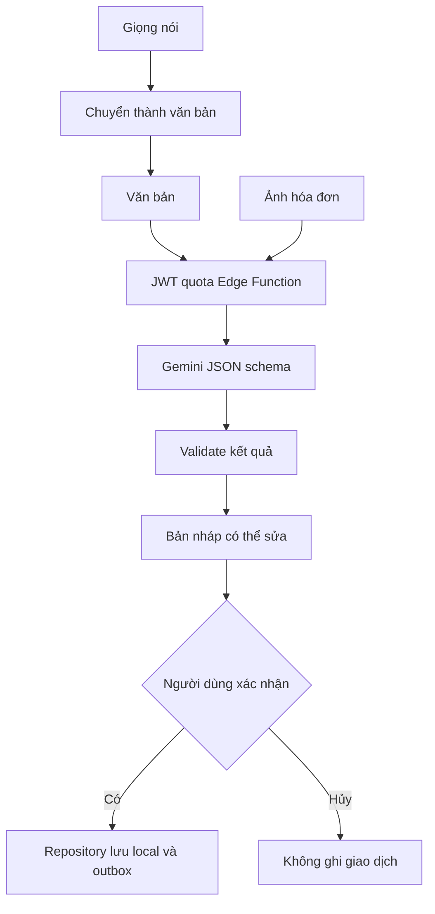

*Hình 6. AI tạo bản nháp và người dùng xác nhận*

### Điều kiện và đầu vào

Có phiên Auth và mạng để gọi AI trực tuyến; đã cấp quyền tương ứng nếu dùng micro hoặc ảnh. Đầu vào là văn bản hoặc ảnh hóa đơn; ảnh được giảm kích thước tối đa 1920 px, chất lượng 85% theo luồng chọn ảnh.

### Xử lý và kết quả

Edge Function kiểm tra người dùng, kích thước và quota, gọi Gemini với schema JSON rồi xác thực số tiền và các trường. App hiển thị tối đa 10 bản nháp để sửa nguồn, danh mục, ngày và nội dung. Người dùng chọn các bản nháp cần ghi và bấm lưu; repository lưu qua đường chuẩn. Ảnh có thể được giữ cục bộ chờ tải riêng tư.

### Ngoại lệ cần xử lý

Không được bịa số tiền còn thiếu. Hủy chọn ảnh hoặc hủy bản nháp không tạo giao dịch. Lỗi ảnh cho phép nhập tay với ảnh đính kèm, không hứa nhận dạng ảnh offline.

### 14 1 Vì sao phải có bản nháp

Hóa đơn có thể chứa tổng tiền, tiền khách đưa, tiền thừa và nhiều mặt hàng; câu nói cũng có thể mơ hồ. Mô hình chỉ gợi ý dữ liệu có cấu trúc. Quyền quyết định cuối cùng nằm ở người dùng, giúp giảm việc biến sai số nhận dạng thành một khoản thu chi đã lưu.

## 15 Quota fallback và nhận xét AI

*Bảng 11. Hạn mức AI theo ngày Việt Nam*

| Luồng | Giới hạn |
| --- | --- |
| Ghi nhanh văn bản | 50 lượt mỗi ngày |
| Quét ảnh | 20 lượt mỗi ngày |
| Nhận xét tài chính | 10 lượt mỗi ngày |

### 15 1 Kiểm soát ở server

Gemini key chỉ nằm trong secret server; Flutter không nhận key này. Edge Functions kiểm tra JWT và quota trước khi gọi mô hình. GEMINI_MODEL có thể cấu hình ở server; mặc định source dùng gemini-flash-latest. Quota là giới hạn kỹ thuật cho việc sử dụng AI, không phải phân tầng gói trả phí.

### 15 2 Fallback có giới hạn rõ ràng

Với văn bản, lỗi mạng hoặc dịch vụ có thể chuyển sang bộ phân tích tiếng Việt cục bộ để tạo bản nháp. Lỗi xác thực 401, hết quota 429 và lỗi đầu vào 400 hoặc 413 cần được thông báo đúng, không che đi bằng fallback. Với ảnh, khi AI không dùng được, người dùng nhập tay; không có OCR offline được cam kết.

### 15 3 Quy tắc danh mục

Sau khi người dùng chỉnh danh mục và xác nhận lưu, ứng dụng có thể học quy tắc cho những mô tả tương tự. Quy tắc chưa được xác nhận không tự trở thành dữ liệu học. Màn quản lý cho phép tắt hoặc xóa quy tắc; nội dung ghi chú của người dùng không bị dịch lại khi đổi giao diện.

### 15 4 Nhận xét tháng và cố vấn

Số liệu thống kê cơ bản được tính từ dữ liệu nghiệp vụ, không giao cho mô hình tự cộng. Nhận xét AI cần mạng và dữ liệu cloud đã đồng bộ; phạm vi có thể là tháng xác định hoặc khoảng 30 và 90 ngày ở luồng tương ứng. Cache có fingerprint để nhận biết dữ liệu thay đổi và đánh dấu nội dung cũ khi cần.

Kết quả nhận xét nhằm giúp người dùng đọc thói quen chi tiêu, không thực hiện quyết định tài chính hay giao dịch tự động. Khi gọi thất bại, các biểu đồ và báo cáo local vẫn có thể sử dụng; UI cần phân biệt số liệu hiện tại với nhận xét được tạo từ một lần dữ liệu trước đó.

## 16 Sửa hoàn tác và lịch sử trả nợ

Nghiệp vụ trả nợ không chỉ là tăng một con số đã trả trên màn hình. Nó phải bảo toàn quan hệ giữa khoản nợ, từng payment, giao dịch dẫn xuất và các operation đồng bộ. Vì vậy quy tắc nằm trong repository thay vì được sao chép vào từng widget UI.

### Điều kiện và đầu vào

Khoản nợ có lịch sử trả; người dùng đang ở đúng tài khoản. Chọn payment, nhập số tiền hoặc ngày mới, bật tắt liên kết, chọn nguồn nếu cần; hoàn tác là yêu cầu bỏ tác dụng lần trả.

### Xử lý và kết quả

Repository kiểm tra tổng sau thay đổi, cập nhật payment và giao dịch liên quan trong cùng transaction, tính lại tổng nợ và ghi outbox tương ứng. Lịch sử, trạng thái nợ và số dư phản ánh cùng một quyết định. Hoàn tác không để lại một khoản chi hoặc thu mồ côi.

### Ngoại lệ cần xử lý

Không cho sửa vượt số còn lại sau khi tính các payment khác. Tham chiếu sai tài khoản bị từ chối. Operation lỗi do dữ liệu server mới phải được giữ để người dùng sửa hoặc lựa chọn, không xóa im lặng.

*Bảng 12. Ví dụ một khoản vay 1.000.000 VND*

| Thao tác | Còn nợ | Tác động khi có liên kết |
| --- | --- | --- |
| Trả 200.000 | 800.000 | Chi 200.000 |
| Sửa lần trả thành 250.000 | 750.000 | Chi được sửa thành 250.000 |
| Tắt ghi vào thu chi | 750.000 | Giao dịch liên kết không còn hiệu lực |
| Bật lại liên kết | 750.000 | Dùng định danh liên kết ổn định |
| Hoàn tác lần trả | 1.000.000 | Loại tác dụng của payment và dòng tiền |

### 16 1 Tính ổn định của liên kết

Giữ định danh liên kết ổn định khi tắt, bật hoặc khôi phục giúp replay và đồng bộ không sinh nhiều giao dịch cho cùng một payment. Dữ liệu legacy được xử lý theo nguồn gốc của nó; không suy đoán thêm dòng tiền. Các quy tắc này cũng là đối tượng của kiểm thử SQL và repository.

## 17 Khoản phải trả và nhắc nhở

### 17 1 Khoản phải trả theo kỳ

Người dùng tạo một việc cần chi trả, số tiền dự kiến và lịch một lần hoặc lặp theo tuần, tháng. Mỗi kỳ được biểu diễn bằng payable_occurrence có định danh ổn định. Với lịch theo tháng, ngày vượt số ngày của tháng được điều chỉnh về ngày hợp lệ cuối tháng.

### Điều kiện và đầu vào

Đã có tài khoản và dữ liệu lịch sẵn sàng; quyền thông báo cần cho nhắc trên thiết bị. Đầu vào gồm tên, tiền dự kiến, ngày đến hạn và chu kỳ.

### Xử lý và kết quả

Repository tạo lịch và các occurrence cần quản lý; scheduler lên lịch nhắc phù hợp. Người dùng mở kỳ, đánh dấu đã trả hoặc đi vào form chi được điền sẵn để xác nhận. Trạng thái từng kỳ được lưu và đồng bộ. Nhắc việc không tự trừ tiền và không tự tạo chi khi chưa có xác nhận.

### Ngoại lệ cần xử lý

Từ chối quyền thông báo chỉ làm mất nhắc ngoài app, không chặn ghi chép. Đổi tháng, sửa lịch và thao tác lặp phải tránh nhân đôi kỳ hoặc giao dịch liên quan.

*Bảng 13. Các loại nhắc việc*

| Loại | Quy tắc chính |
| --- | --- |
| Nợ | Theo hạn; cron server 08 giờ Việt Nam, có trước hạn, đến hạn và quá hạn theo logic server. |
| Nhật ký | Mặc định tắt; khi bật dùng giờ nhắc mặc định 21 giờ theo cấu hình. |
| Báo cáo tháng | Nhắc vào đầu tháng để xem kỳ đã kết thúc. |
| Khoản phải trả | Theo lịch từng occurrence và lựa chọn người dùng. |

### 17 2 Tránh tranh chấp điều hướng

Khi người dùng đang thao tác từ widget hoặc sửa form, nhắc nợ tự động phải đợi. Thông báo không được đẩy một màn lên làm mất bản nháp đang nhập. Đổi ngôn ngữ làm mới nội dung nhắc local nhưng giữ ID, lịch và route, không tự xin lại quyền thiết bị.

## 18 Thống kê báo cáo và CSV

### 18 1 Báo cáo theo tháng

Điều kiện: có dữ liệu local của kỳ cần xem. Người dùng chọn tháng; hệ thống tính tổng thu, tổng chi, chênh lệch và phân bổ danh mục từ giao dịch còn hiệu lực. So sánh sử dụng tháng dương lịch liền trước, không thay bằng 30 ngày trượt. Biểu đồ danh mục nhóm Top 5 và phần còn lại khi cần.

Báo cáo local vẫn đọc được khi mất mạng. Nhận xét AI là phần bổ sung, cần mạng và trạng thái cloud phù hợp; UI thể hiện cache cũ nếu dữ liệu đã đổi. Không lấy số dư nguồn tiền thay cho thu nhập tháng vì số dư còn bao gồm lịch sử và số dư ban đầu.

### 18 2 Xuất và nhập CSV

CSV phục vụ trao đổi giao dịch, không phải bản sao lưu toàn bộ tài khoản. File dùng UTF-8 có BOM, số tiền nguyên và thời điểm theo hợp đồng của dự án. Khi nhập, ứng dụng đọc preview, ánh xạ cột, kiểm tra từng dòng và các dấu hiệu trùng trước khi ghi. Giới hạn nhập là 10.000 dòng.

*Bảng 14. Điều kiện của luồng CSV*

| Bước | Đầu vào hoặc kết quả |
| --- | --- |
| Chọn file | File CSV có encoding và cấu trúc đọc được. |
| Preview và mapping | Người dùng xem cột, chọn ánh xạ và kiểm tra mẫu số tiền, ngày. |
| Validate | Báo lỗi từng dòng; không ghi đè các ID đã tồn tại. |
| Xác nhận | Các giao dịch được nhập qua logic lưu local và outbox. |
| Xuất | Chỉ xuất giao dịch trong phạm vi chọn, giữ số nguyên và hợp đồng cột. |

### 18 3 Ngoại lệ

File quá lớn, cột thiếu, ngày không hợp lệ hoặc tiền không đúng định dạng phải có thông báo dễ hiểu. Lỗi dòng không nên biến thành thông báo SQL thô. Đổi giao diện sang tiếng Anh không tự đổi schema CSV, múi giờ nghiệp vụ hoặc dịch ghi chú người dùng. Người nhận cần dùng chức năng xuất phù hợp thay vì sao chép trực tiếp file SQLite.

## 19 Widget Android ghi nhanh

Widget Túi Khôn có ba nút ngắn kèm icon theo thứ tự Chi, Quét ảnh, Thu, kích thước mặc định 4×2 và có thể thay đổi theo launcher. Không hiển thị số dư hoặc thông tin tài khoản trên màn hình chính.

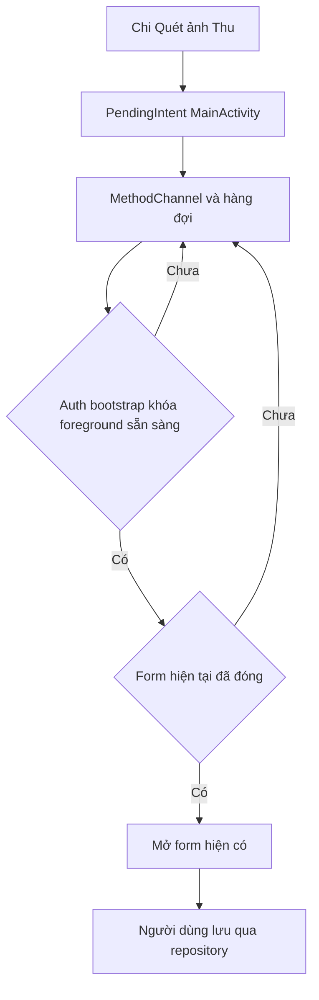

*Hình 7. Từ widget đến form hiện có*

### Điều kiện và đầu vào

Android launcher đã đặt widget; người dùng chạm một trong ba nút. Native nhận action expense, scanReceipt hoặc income qua PendingIntent tường minh, immutable tới MainActivity.

### Xử lý và kết quả

MethodChannel tui_khon/home_widget chuyển action sang Flutter cả lúc khởi động nguội lẫn đang chạy. Hàng đợi đợi tài khoản, bootstrap, sinh trắc và foreground; sau đó mở form thu chi hoặc màn quét ảnh. Người dùng kiểm tra và lưu qua repository chung. Native không ghi SQLite hoặc gọi RPC thay người dùng.

### Ngoại lệ cần xử lý

Bấm lặp không mở trùng; khi form đang mở chỉ giữ yêu cầu mới nhất đến lúc đóng. Đăng xuất hoặc đổi tài khoản hủy yêu cầu cũ. Hủy form không tạo giao dịch.

### 19 1 Theme ngôn ngữ và riêng tư

Nhãn Việt Anh từ ARB được truyền về native cùng theme để cập nhật các instance. Cache chỉ chứa lựa chọn giao diện, ngôn ngữ và nhãn; không chứa token, ID tài khoản hoặc dữ liệu tiền. Hướng dẫn thêm widget nằm trong Cá nhân. Action quickRecord cũ vẫn được giữ trong hợp đồng nội bộ để tương thích.

### 19 2 Phạm vi mobile

Widget là điểm vào của một thao tác có xác nhận, không phải cơ chế giao dịch nền. Các kiểm tra chữ lớn, nhiều instance, theme và quay lại từ nền nhằm đảm bảo thao tác nhanh vẫn tuân thủ khóa app và không thay thế nội dung đang nhập.

## 20 Ảnh giao diện và dữ liệu minh họa

Hai ảnh được lấy từ lượt kiểm tra Android với dữ liệu QA cô lập, không phải số liệu tài chính của người dùng thật. Ảnh hỗ trợ trình bày khi máy chiếu hoặc thiết bị demo không sẵn sàng; chúng không thay thế bằng chứng của một lần gọi AI trực tuyến.

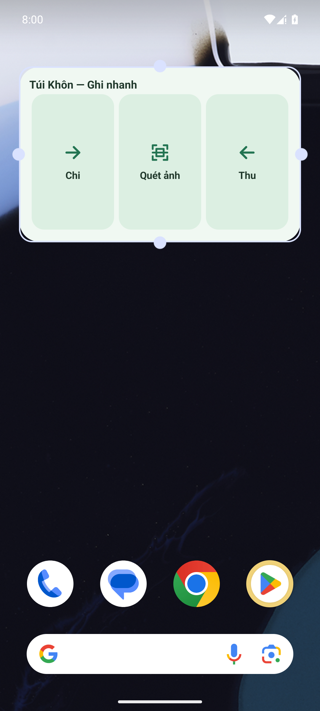

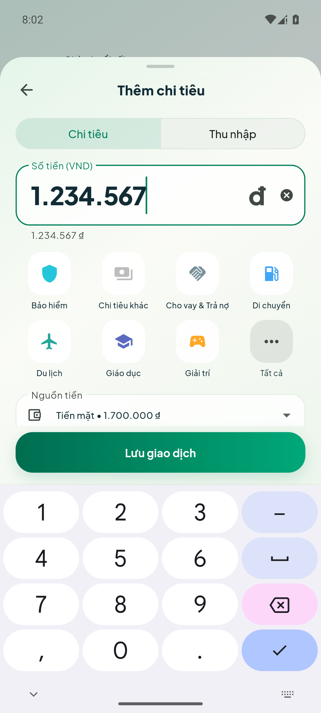

*Hình 8. Widget launcher và ô nhập tiền trên Android*

### 20 1 Cách đọc ảnh

Ảnh trái minh họa ba lối vào Chi, Quét ảnh và Thu từ launcher. Ảnh phải cho thấy định dạng hàng nghìn ngay trong ô nhập, giảm rủi ro đọc nhầm số 0. Trong slide, ảnh được đưa vào khung điện thoại và có thể phóng lớn phần quan trọng để khán giả theo dõi.

### 20 2 Tiêu chí sử dụng ảnh

Không dùng screenshot như bằng chứng Google, SMTP hoặc Gemini đã qua nghiệm thu thật. Những chức năng đó được mô tả theo thiết kế với môi trường cấu hình đầy đủ. Hình của luồng AI trong tài liệu là sơ đồ xử lý bản nháp, còn ảnh Android hiện có là kết quả QA được ghi trong HANDOFF.

## 21 Đồng bộ offline và idempotency

Outbox là hàng đợi bền vững, không chỉ là danh sách request trong RAM. Mỗi operation có op_id ổn định; retry giữ cùng định danh và cùng payload đã gửi. UUID nhận diện bản ghi, còn op_id nhận diện một lần thay đổi; hai khái niệm không thể hoán đổi.

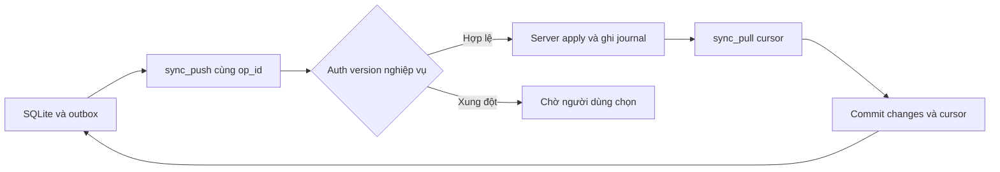

*Hình 9. Đồng bộ push pull và lưu cursor*

### 21 1 Khi nào thử đồng bộ

SyncController có thể chạy lúc khởi động, resume, mạng trở lại, sau thay đổi local với debounce 700 ms, chu kỳ 30 giây khi app hoạt động và khi người dùng yêu cầu. Những trigger này không có nghĩa hệ điều hành cho app chạy nền liên tục; khi bị dừng tiến trình, outbox đợi lần mở tiếp theo.

### 21 2 Version và replay

Create dùng base_version 0. Với update hoặc delete, base_version biểu diễn bản server mà thay đổi local dựa vào. Server ghi nhớ operation đã áp dụng để request lặp không tạo tác dụng lần hai. Nếu server đã áp dụng nhưng response bị mất, client có thể retry an toàn thay vì tạo UUID mới và nhân đôi giao dịch.

### 21 3 Tombstone và cursor

Xóa logic truyền được sự kiện xóa tới máy chưa online. Pull lấy change theo seq tăng dần; cursor đánh dấu trang đã áp dụng, không phải thời điểm đồng hồ điện thoại. Dữ liệu trang và cursor được commit chung để không có tình trạng bỏ qua một phần thay đổi sau khi app bị đóng.

### 21 4 Ảnh và sự cố

Ảnh có trạng thái tải riêng để giao dịch vẫn được lưu trước khi mạng sẵn sàng. Lỗi xác thực cần người dùng đăng nhập lại; lỗi nghiệp vụ hoặc xung đột phải hiển thị cho xử lý. Không xóa toàn bộ SQLite hay reset backend để giải quyết một operation lỗi.

## 22 Phát hiện và lựa chọn xung đột

Xung đột xuất hiện khi hai thiết bị sửa một bản ghi từ cùng phiên bản. Hệ thống giữ bản local và server để người dùng xem rồi chọn; không lấy thời điểm sửa mới nhất làm lý do ghi đè im lặng.

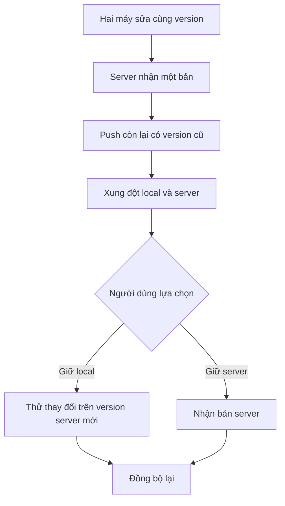

*Hình 10. Xung đột phiên bản và hai nhánh lựa chọn*

### 22 1 Hai quyết định được hỗ trợ

Giữ bản trên máy tạo quyết định dựa trên phiên bản server hiện biết để thử đồng bộ lại theo logic hiện có; nếu có thay đổi mới nữa vẫn phải xử lý tiếp. Giữ bản server nhận dữ liệu server và bỏ tác dụng của thay đổi local xung đột tương ứng. UI cần chỉ rõ cả hai bản, đặc biệt định dạng tiền đúng ngôn ngữ.

*Bảng 15. Bằng chứng trên hai emulator ngày 05 11 2026*

| Bước | Kết quả đã quan sát |
| --- | --- |
| Tạo offline 1.234.567 VND | SQLite và outbox tồn tại sau force-stop, cloud chưa có dòng. |
| Bật mạng và lặp sync | Hai máy cùng UUID, version 1; cloud chỉ một giao dịch. |
| Hai máy sửa 1.500.000 và 1.600.000 | Chọn giữ local; hai máy nhận 1.600.000, version 3. |
| Lặp với 1.700.000 và 1.800.000 | Chọn server; hai máy nhận 1.700.000, version 4. |
| Cài APK khi còn xung đột | Dữ liệu và hai bản local server được giữ lại. |

### 22 2 Giới hạn của kết luận

Kiểm tra này chứng minh các nhánh offline và lựa chọn trên hai emulator với tài khoản fixture. Nó không thay thế kiểm thử PostgreSQL nhiều connection đồng thời. Cơ chế concurrency cần được chạy riêng trong môi trường thử dùng chung dữ liệu và khóa server; không được tính file hướng dẫn kiểm thử là một suite đã qua.

## 23 Bảo mật và quyền riêng tư

### 23 1 Xác thực và phân quyền

Supabase Auth xác định người dùng qua JWT. RLS trên các bảng public giới hạn dữ liệu theo tài khoản, đồng thời RPC xác minh quyền sở hữu các liên kết. Việc UI ẩn nút hoặc SQLite tách file là lớp trải nghiệm và cách ly local; chúng không thay thế kiểm soát quyền ở server.

*Bảng 16. Lớp bảo vệ và giới hạn*

| Lớp | Thiết kế |
| --- | --- |
| Secret | Gemini key và service role chỉ ở server hoặc công cụ quản trị, không đóng gói trong Flutter. |
| Ảnh hóa đơn | Bucket receipts private; URL ký có hạn tạm thời 15 phút theo luồng hiện tại. |
| Sinh trắc | Khóa app tùy chọn, kiểm tra lại sau thời gian ở nền trên 60 giây; không thay JWT backend. |
| Kho local | Tách tài khoản trong vùng lưu trữ app; không tuyên bố SQLite đã được mã hóa chỉ vì dùng Drift. |
| Widget | Chỉ action cố định và metadata giao diện; không cache tài khoản, số dư hay token. |
| Nhật ký và cấu hình | Không commit env thật, credential, DB hoặc backup vào Git. |

### 23 2 Quyền thiết bị

Micro phục vụ chuyển lời nói thành chữ; camera hoặc thư viện ảnh phục vụ hóa đơn; thông báo phục vụ nhắc việc; sinh trắc do hệ điều hành xác thực. Người dùng từ chối hoặc hủy một quyền phải có đường tiếp tục nhập tay phù hợp. Việc không cấp thông báo không được ngăn lưu thu chi.

### 23 3 Theme ngôn ngữ và khả năng tiếp cận

UI tái sử dụng semantic colors, font Plus Jakarta Sans đóng gói và ARB Việt Anh. Cần kiểm tra màn nhỏ, chữ 200%, bàn phím và các sheet. Đổi ngôn ngữ chỉ đổi nhãn và cách trình bày số; không đổi đơn vị VND, kỳ Việt Nam, hợp đồng CSV hay nội dung người dùng và AI.

### 23 4 Phạm vi an toàn

Ứng dụng không nắm giữ tiền hoặc thực hiện lệnh chuyển khoản. Không vì vậy mà dữ liệu chi tiêu bớt riêng tư: ảnh, ghi chú và lịch sử nợ vẫn cần quyền sở hữu đúng, tài khoản QA cô lập và quy trình dọn fixture có kiểm tra danh tính.

## 24 Kiểm thử và kết quả xác minh

Các số liệu dưới đây lấy từ bàn giao và kết quả đã ghi nhận đến ngày 05/11/2026. Việc biên soạn tài liệu không tạo thêm lượt nghiệm thu dịch vụ. Chỉ số test là bằng chứng trong phạm vi đã chạy, không đồng nghĩa mọi thiết bị hoặc nhà cung cấp đều đã được kiểm tra.

*Bảng 17. Kết quả kiểm tra đã có*

| Hạng mục | Kết quả và phạm vi |
| --- | --- |
| Flutter | 431 test qua; gồm nghiệp vụ, repository, widget, định dạng tiền và các màn. |
| Static analysis | Không có error hoặc warning; còn 197 info lint khi chạy --no-fatal-infos. |
| SQL in-memory | 6 nhóm kiểm tra qua; không phải kiểm thử PostgreSQL nhiều connection. |
| Edge Functions | 7 test và type-check qua; kiểm tra logic không thay gọi Gemini thật. |
| Android APK | Debug APK từ lib/main.dart build được; đã cài cập nhật giữ SQLite. |
| Cloud | Hai emulator bootstrap, offline retry, chọn local và chọn server; dữ liệu fixture được dọn có guard. |
| Widget và nhập tiền | Nhiều instance, mở Chi, định dạng 1.234.567 và hủy không thêm giao dịch. |

### 24 1 Các lớp kiểm thử

Unit test kiểm tra công thức, parser và bất biến. Repository test kiểm tra atomicity, trả nợ, dữ liệu cục bộ và outbox. Widget test kiểm tra điều hướng, trạng thái khóa, theme và ngôn ngữ. SQL kiểm tra quyền, version, replay và liên kết ở backend. Emulator kiểm tra vòng đời Android và tương tác với cloud thật bằng tài khoản QA riêng.

### 24 2 Tiêu chí tiếp tục nghiệm thu

Trước buổi demo online cần kiểm tra Google đăng nhập bằng đúng client và SHA-1, SMTP gửi được OTP và Gemini trả bản nháp. Các kiểm tra đó không được cộng vào số liệu ở bảng nếu chưa thực hiện. Camera, micro và sinh trắc trên máy vật lý, iOS, concurrency SQL và release store cũng cần bằng chứng riêng.

### 24 3 Giữ dữ liệu trong quá trình kiểm tra

Fixture dùng tài khoản cô lập; kiểm tra cloud có rollback hoặc identity guard khi dọn. Không reset DB, volume hay tài khoản thật để làm test xanh. Một thay đổi sync hoặc migration cần chạy thêm SQL regression, không chỉ chạy Flutter test.

## 25 Kịch bản demo và thuyết trình

Bài thuyết trình có 18 slide cho 12–15 phút. Người trình bày giới thiệu vấn đề trước, sau đó đi từ thao tác người dùng đến kiến trúc đảm bảo tính đúng. Phần demo ưu tiên ba tình huống ngắn; ảnh và sơ đồ dự phòng giúp vẫn giải thích được luồng nếu thiết bị trình chiếu gặp sự cố.

*Bảng 18. Runbook demo*

| Kịch bản | Thao tác và điều cần quan sát |
| --- | --- |
| 1 Ghi từ widget khoảng 45 giây | Chạm Chi, nhập 1234567, thấy 1.234.567; kiểm tra nguồn và bấm Lưu; lịch sử có đúng một khoản. |
| 2 AI tạo bản nháp khoảng 60 giây | Chọn Quét ảnh hoặc nhập câu mẫu; chỉ ra bản nháp, sửa danh mục hoặc tiền rồi xác nhận; trước xác nhận chưa có giao dịch. |
| 3 Offline và đồng bộ khoảng 90 giây | Tắt mạng một máy, ghi khoản mẫu, mở lại thấy còn; bật mạng, sync máy hai và đối chiếu UUID hoặc giao dịch duy nhất. |
| 4 Xung đột nếu đủ thời gian | Hai máy sửa cùng dữ liệu; mở màn sync và giải thích chọn local hoặc server; dùng ảnh dự phòng nếu thiếu thời gian. |

### 25 1 Chuẩn bị

Dùng hai emulator hoặc thiết bị thử với cùng tài khoản QA, dữ liệu mẫu cô lập và mạng ổn định. Cài cùng APK, đặt widget trước, đăng nhập và bootstrap xong. Cấu hình dịch vụ trực tuyến trước buổi trình bày; không mở màn chứa secret hoặc dùng hóa đơn có thông tin cá nhân thật.

### 25 2 Khi không demo trực tiếp

Ảnh widget và ô nhập tiền minh họa lối vào và định dạng. Ảnh cloud-conflict-amounts minh họa hai bản giá trị được giữ. Sơ đồ AI mô tả rõ bước tạo bản nháp và xác nhận; không gọi một ảnh sơ đồ là kết quả Gemini đã chạy. Ghi chú người nói trong HTML có ý chính và câu nối cho từng slide.

### 25 3 Phân chia trình bày

Nhóm bổ sung họ tên, MSSV và phân công vào phần đầu báo cáo trước khi nộp. Có thể chia theo sản phẩm và demo, kiến trúc và dữ liệu, kiểm thử và tổng kết tùy số thành viên thực tế. Tài liệu không ấn định số người hoặc gán công việc cho một cá nhân chưa được cung cấp.

## 26 Chạy source bài học và phát triển

### 26 1 Chạy nhanh

Cài Flutter và Android SDK phù hợp SETUP.md; kiểm tra flutter doctor -v. Chạy flutter pub get và flutter gen-l10n từ gốc repo. Điền URL, publishable key và Google Web client ID vào cấu hình Flutter bị Git bỏ qua; dùng --dart-define-from-file=.env khi chạy hoặc build. Gemini key chỉ cấu hình trên server, không đặt vào file định nghĩa đóng gói cho app.

Lệnh tiêu biểu: flutter run --dart-define-from-file=.env. Kiểm tra source bằng flutter analyze --no-fatal-infos và flutter test. Build thử nội bộ bằng flutter build apk --debug --dart-define-from-file=.env. Chi tiết Supabase migrations, secrets, SMTP templates, Google client và SHA-1 xem SETUP.md; giữ dữ liệu cũ theo docs/OFFLINE_UPGRADE.md, không reset để nâng cấp.

### 26 2 Bài học kỹ thuật

Offline-first yêu cầu coi lưu bền vững và đồng bộ là hai thời điểm khác nhau. Tách repository giúp cùng quy tắc được dùng bởi form, AI, CSV và widget. Giữ tiền nguyên tránh sai số; dữ liệu liên kết cần transaction và định danh ổn định. Kiểm thử nhiều tầng giúp phát hiện lỗi mà ảnh UI không thấy, chẳng hạn outbox thiếu hoặc payment tạo trùng tiền.

### 26 3 Hướng phát triển

Ưu tiên nghiệm thu tích hợp trực tuyến và thiết bị vật lý, chạy concurrency PostgreSQL, hoàn thiện đóng gói release và theo dõi lỗi vận hành. iOS cần build và kiểm tra vòng đời riêng. Các cải tiến sản phẩm có thể tập trung chất lượng phân loại, khả năng tiếp cận và báo cáo; vẫn giữ phạm vi sổ ghi chép và nguyên tắc người dùng xác nhận.

### 26 4 Tài liệu đối chiếu

- docs/HANDOFF.md mục 9 và 10: widget, định dạng tiền và bằng chứng hai emulator.
- docs/NGHIEP_VU.md và docs/OFFLINE_UPGRADE.md: quy tắc nghiệp vụ và nâng cấp giữ dữ liệu.
- SETUP.md, pubspec.yaml và pubspec.lock: môi trường, cấu hình và dependency.
- lib/core/offline/ và lib/core/home_widget/: kho local, đồng bộ và hàng đợi widget.
- lib/features/ và supabase/migrations/: chức năng, ràng buộc và hợp đồng server.
- supabase/functions/, supabase/tests/README.md và test/: logic AI và phạm vi kiểm thử.

Thuật ngữ: outbox là hàng đợi thay đổi bền vững; tombstone là dấu xóa logic; idempotency là gửi lại cùng operation không lặp tác dụng; cursor là vị trí đã áp dụng trong nhật ký đồng bộ. Báo cáo và slide mô tả cùng snapshot source tại thời điểm biên soạn.
